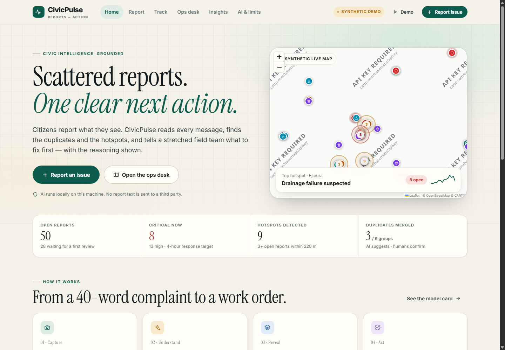

# CivicPulse

**Scattered civic reports → one prioritised, explainable action list.**

CivicPulse is a runnable prototype for a city complaints desk. A citizen describes an issue, pins it on a map, and optionally adds a photo. A deterministic AI pipeline categorises it, writes a short summary, checks for nearby duplicates, and scores urgency with visible reasons. Staff get a queue, a map, hotspot briefs and a workflow. Citizens can track the same report by ID and see every status change.

Built for an 8-hour solo hackathon. All 63 reports are synthetic. Nothing here talks to a real municipal system.



> Screenshots are optional; run the app to see the live interface.

---

## Quick start

Requirements: **Node.js 20+** (tested on Node 26) and npm.

```bash
npm install
npm run setup:model   # optional but recommended: download the local BGE model (~33 MB)
npm start
```

Open **http://127.0.0.1:4173**.

```bash
npm test              # fast checks for the AI pipeline (no server needed)
npm run reset         # restore the 63 synthetic seed reports and clear uploaded photos
npm run eval:duplicates  # optional: compare TF-IDF vs BGE on the 31 duplicate pairs
npm run eval:seed        # optional: inspect duplicate scores and clusters in the seed data
```

The first `npm install` downloads `@xenova/transformers`. Run `npm run setup:model` once to fetch the BGE-small model (~33 MB) into `models/`; after that, duplicate detection runs locally without a network call. If the model is absent or cannot load, the app still starts and falls back to TF-IDF duplicate scoring.

### Demo controls

Use the **Demo** button in the header to:

- reset the dataset to the 63 synthetic reports;
- inject a simulated surge of new reports;
- download the current queue as CSV.

---

## What the four stages do

| Stage | Citizen sees | Staff sees |
| --- | --- | --- |
| **Capture** | Three-step form: describe, pin, review. Photo is compressed in the browser. | — |
| **Understand** | Live triage card: category, confidence, summary, priority, duplicate check, reasons. | Same card plus compare-priority and override controls. |
| **Reveal** | Track page with map and public timeline. | Ops map, filters, hotspot cards, 14-day trend, area watchlist, duplicate groups, action brief. |
| **Act** | Status, team, public updates, confirmations. | Review, assign, change status, link duplicates, comment, resolve. |

Routes:

| Route | Purpose |
| --- | --- |
| `#/` | Home and live city snapshot |
| `#/report` | Citizen capture flow |
| `#/track` | Track by report ID |
| `#/ops` | Staff operations desk |
| `#/insights` | Hotspots, trends, duplicate groups, action brief |
| `#/ai` | How the AI works, model card, benchmark, live playground, honesty note |

Deep links used in the demo:

- `#/ops/report:CP-1009`
- `#/ops/cluster:hs-ejipura-12.930-77.621`
- `#/ops/area:Ejipura`

---

## Architecture

```
Browser (vanilla ES modules, no framework)
  public/js/views/*.js          home, report, track, ops, insights, ai
  public/js/map.js              Leaflet wrapper + local tiles
  public/js/ui.js               icons, badges, formatters, modal/toast
        │
        │ JSON over fetch
        ▼
Node HTTP server (server.js, no web framework)
  lib/store.js                  state, seed/reset, actions, CSV, photos
  lib/ai.js                     classifier, duplicates, priority, summaries,
                                DBSCAN hotspots, briefs, model card
  lib/embeddings.js             local BGE-small ONNX embeddings
  lib/seed.js                   63 synthetic reports + surge specs
  lib/geo.js                    categories, teams, statuses, localities
        │
        ▼
data/state.json                 JSON persistence (atomic replace)
uploads/                        citizen photos
public/tiles/                   prefetched CARTO light tiles, z12–15
models/Xenova/bge-small-en-v1.5 local quantized embedding model (npm run setup:model)
```

There is **no build step**. The server serves static files, the JSON API, uploaded photos and map tiles. The SPA uses hash routing so it works without a rewrite rule.

---

## The AI, honestly

The default pipeline is **deterministic and local**. No text leaves the machine. No generative model is required. The optional LLM adapter is off unless you configure it.

### 1. Category classification

A **multinomial Naive Bayes** classifier over unigrams + bigrams, stopword removal and light suffix stemming, combined with a small hand-written civic lexicon (phrases such as “live wire”, “open manhole”, “no water”, “knee-deep”).

- 8 categories: Waterlogging, Drainage, Road Damage, Waste Overflow, Streetlight, Safety Hazard, Water Supply, Public Property.
- 193 labelled synthetic training examples.
- 5-fold cross-validation on the training corpus: **0.896 accuracy / 0.897 macro-F1** for the hybrid, versus **0.534 accuracy** for Naive Bayes alone.
- The split is not an independent real-world evaluation. The lexicon was written by the same person who wrote the examples, so treat this as a sanity check.

Every prediction exposes its evidence: matched phrases, top weighted tokens, confidence and method.

### 2. Duplicate detection

Each new report is compared with every open, non-rejected report using:

```
score = 0.60 × text similarity
      + 0.22 × geographic proximity
      + 0.10 × category match
      + 0.08 × time decay
```

Text similarity uses **BGE-small-en-v1.5** sentence embeddings (384 dimensions, quantized ONNX, CPU) with cosine similarity. Geographic proximity decays exponentially over 320 m; time decays over 12 days. A pair is labelled **likely duplicate** at **0.78** and **related** at **0.62**. If embeddings are unavailable, the app falls back to TF-IDF cosine with a conservative 0.62 / 0.46 pair of thresholds.

On the 31 hand-labelled synthetic pairs:

| Mode | Best F1 | Operating point |
| --- | --- | --- |
| TF-IDF fallback | 0.727 @ 0.38 | 0.62 (conservative; low recall on the benchmark) |
| BGE-small semantic | 0.821 @ 0.72 | **0.78**: precision 0.765, recall 0.813, F1 0.788 |

The operating threshold is deliberately **above** the F1-optimal point. Merging two real issues is worse for citizens than asking a dispatcher to check a near-miss. **The AI only suggests; a staff member confirms every duplicate link.** The fallback is materially weaker than the semantic path and is disclosed on the AI page.

### 3. Priority

An explainable weighted rubric, not a black box. It adds points for:

- category baseline risk;
- life-safety / hazard language (`+32`), or moderate hazard language (`+8`);
- vulnerable place nearby (`+8`);
- impact on people or movement (`+10`);
- public-health signals (`+6`);
- night-time streetlight safety (`+10`);
- loss of essential water supply (`+10`);
- confirmed duplicates (`+5` each, max 15);
- unconfirmed similar reports (`+4` each, max 12);
- hotspot size (`+10` or `+14`);
- citizen confirmations (`+2` each, max 8);
- age while unresolved (`+4` or `+6`);
- penalties for cosmetic language (`-6`) and very short descriptions (`-4`).

Levels and response targets: **Critical ≥ 76 / 4 h**, **High ≥ 55 / 24 h**, **Medium ≥ 30 / 72 h**, **Low / 168 h**. The UI shows every factor, not just the score.

### 4. Summaries and action briefs

Summaries are **extractive**, not generative. The system scores sentences against the category, picks the most informative one, adds extracted signals (quantities, impacted groups, duration), and falls back to a template. Action briefs are templates over computed cluster statistics, with a hypothesis, evidence, recommended owner, first step, confidence and unknowns.

### 5. Hotspots

**DBSCAN** over haversine distance, with `eps = 220 m` and `minPoints = 3`, restricted to open, non-duplicate reports. Each cluster gets a severity score, dominant category, trend, hypothesis, recommended team and a one-click brief. This is how nine separate Ejipura complaints become one drainage hypothesis instead of nine queue items.

### 6. Optional LLM adapter

Set all three of `CIVIC_LLM_URL`, `CIVIC_LLM_KEY` and `CIVIC_LLM_MODEL` to enable an OpenAI-compatible chat endpoint. It is used **only** to rewrite a summary or brief. It is never used for classification, duplicate decisions or priority, and the UI labels it when enabled. It is disabled by default.

---

## Synthetic dataset

`lib/seed.js` generates **63 reports** across Bengaluru localities, with realistic timestamps relative to the reset time. The set deliberately includes:

- a dense **Ejipura** cluster (8 open reports: waterlogging, blocked drains, road damage, waste, contaminated water, an open manhole);
- linked duplicates (CP-1002 → CP-1001, CP-1012 → CP-1011, CP-1020 → CP-1019);
- critical safety issues (live wire near a school, open manhole, contaminated water);
- resolved history and in-progress work so the timeline is not all “new”;
- reports in 25 approximate localities across South, East and Central Bengaluru.

All names, phone numbers, addresses and reporter identities are fictional. There is no real personal data. Locality coordinates are approximate centroids, not official ward boundaries.

On a fresh reset the dataset typically produces **9 hotspots, 6 duplicate groups, 8 critical reports and ~35 overdue items**. Counts move as the demo is used and as “now” advances.

---

## API

| Method | Path | Purpose |
| --- | --- | --- |
| GET | `/api/health` | Liveness |
| GET | `/api/bootstrap` | Reports, insights, config, model card |
| GET | `/api/insights` | Recomputed insights |
| GET | `/api/model` | Model card and benchmarks |
| GET | `/api/reports/:id` | One report |
| POST | `/api/reports` | Create a report (text, category, location, photo) |
| PATCH | `/api/reports/:id` | Status, assign, comment, confirm, link/unlink duplicate, override category |
| POST | `/api/analyze` | Live triage preview; accepts text, optional location and category |
| GET | `/api/compare?a=…&b=…` | Side-by-side priority comparison |
| GET | `/api/export.csv` | CSV export |
| POST | `/api/demo/reset` | Reset to seed |
| POST | `/api/demo/surge` | Inject simulated surge |

---

## Project structure

```
server.js                 HTTP server, static files, tiles, uploads, API
lib/ai.js                 classifier, duplicates, priority, summaries, DBSCAN, briefs
lib/embeddings.js         BGE-small loader/cache/cosine
lib/store.js              state, actions, seed/reset, persistence, CSV
lib/seed.js               63 synthetic reports + surge
lib/corpus.js             193 training examples + 31 duplicate pairs
lib/geo.js                categories, teams, statuses, localities
public/                   SPA, CSS, Leaflet, fonts, local map tiles
models/                   downloaded BGE-small ONNX model
scripts/test-ai.js        npm test
scripts/reset.js          npm run reset
scripts/eval-*.js         optional offline evaluation helpers
data/state.json           persisted demo state (created on first run)
uploads/                  citizen photos (created on first run)
```

---

## Environment variables

| Variable | Default | Effect |
| --- | --- | --- |
| `PORT` | `4173` | HTTP port |
| `HOST` | `127.0.0.1` | Bind address |
| `LOG_REQUESTS` | off | Set `1` for request logs |
| `CIVIC_EMBEDDINGS` | on | Set `off` to force TF-IDF fallback |
| `CIVIC_EMBEDDING_MODEL` | `Xenova/bge-small-en-v1.5` | Alternative local model id |
| `CIVIC_LLM_URL` | — | OpenAI-compatible base URL |
| `CIVIC_LLM_KEY` | — | API key |
| `CIVIC_LLM_MODEL` | — | Model name |

The LLM is enabled only when all three LLM variables are present.

---

## Demo, limitations and honesty

- **5-minute demo script:** [DEMO.md](DEMO.md)
- **Limitations & Honesty:** [LIMITATIONS.md](LIMITATIONS.md)

The short version: the triage, duplicate scoring, priority rubric, hotspot detection, workflow and persistence are real code running locally. The dataset is synthetic. There is no live municipal integration, no image understanding, no authentication, no notifications, and no production database. The AI is a decision-support tool, not an autonomous dispatcher.
